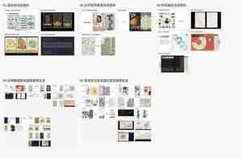

# 案例图片分类与归档

本目录采用“双轴分类、单份存储”的方式整理三份课程 PDF 中的案例图。

- **主存储轴：视觉表现类型**，决定原图保存在哪个子目录。
- **辅助标签轴：数据架构逻辑**，记录编年、层级、编目、字母表、地理或混合关系。
- **来源轴：课程讲次与 PDF 页码**，确保每张图都能追溯到原始课件。

## 课程案例总览

> 总览图用于快速浏览；详细分类依据、案例名称和页码见[06-案例图像分类索引](../../../06-案例图像分类索引.md)。

## 目录结构

| 目录 | 归档内容 |
|---|---|
| 01-混合型信息图形 | 图表、文字、地图、符号、插画等多种视觉语法组合 |
| 02-文字型列表型信息图形 | 列表、条目、编号、目录和卡片式信息 |
| 03-时间轴型信息图形 | 事件顺序、阶段、时间跨度和历史变化 |
| 04-其他常见信息图形类型 | 示意、流程、比较、地标、图片式、层级、单图表、视觉文本、解剖、简历、手稿、编年+编目、3D，以及五种数据架构和统计图表补充案例 |

04 文件夹内进一步按子类型建立目录，避免所有“其他”案例混放。

## 统一编号与命名

推荐格式：类型缩写 + 三位编号 + 主题关键词 + 讲次/页码。

例如：
- GEO-001-霍乱地图-L1-P18.jpg
- CMP-001-失业率比较图-L2-P12.jpg
- TIM-001-螺旋时间轴-L3-P03.jpg

建议类型缩写：
MIX 混合型；LST 列表型；TIM 时间轴；HOW 示意图；PRO 流程图；CMP 比较型；LOC 地标型；PHO 图片式；HIE 层级型；SIN 单一图表；VTX 视觉化文本；ANA 解剖型；RES 视觉简历；MAN 手稿型；CMB 编年+编目；3D 三维；CAT 编目型；ALP 字母表型；GEO 地理型；BAS 基础统计图表；NET 关系网络；INT 交互/仪表板。

## 入库规则

1. 每个案例确定一个主视觉表现类型，原图只保存一份。
2. 数据架构、辅助表现、领域和交互属性写入案例索引，不重复存图。
3. 原图保留 original；裁切图、标注图另存 cropped 或 annotated。
4. 记录原始 PDF 文件名、PDF 页码、作者/机构、年份和原始链接；未知信息标记“待核实”。
5. 不把课程授课者误记为案例作者。
6. 归类依据是主要信息关系和读者任务，不是配色或装饰风格。
7. 详细案例页码与分类依据见[06-案例图像分类索引](../../../06-案例图像分类索引.md)。

## 当前状态

当前仓库已有课程案例总览图和完整的 PDF 页码分类索引。单张原始案例图仍位于三份课程 PDF 中，后续导出原图时按本目录的主类型文件夹入库；不将课件整页截图冒充原始案例图。
