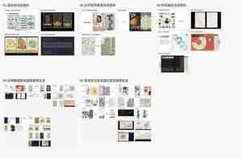

# 06 三份课程资料案例图像分类索引

> 本索引将三份课程 PDF 中实际展示的案例图按“数据架构逻辑”和“视觉表现类型”双轴整理。两套分类回答不同问题：数据架构决定信息关系，视觉表现决定画面组织方式。每张案例图只归入一个主目录，辅助类型在索引中交叉标注。

## 一、原始资料与页码规则

| 代号 | 原始文件 | PDF 页数 | 内容 |
|---|---|---:|---|
| L1 | 《信息图表与数据可视化-1.pdf》 | 41 | 信息图表设计导论 |
| L2 | 《第二讲(1).pdf》 | 36 | 数据类型与基础图表 |
| L3 | 《第三讲-信息图形类型学.pdf》 | 73 | 信息图形类型学 |

下文页码均为 PDF 阅读器页码，不是课件中可能出现的章节页码。

## 二、第一条分类轴：五种数据架构逻辑

### 01 编年型（Chronological）

核心关系：事件先后、阶段、持续时间和时间间隔。

| 来源 | 页码 | 案例图/主题 | 可观察的组织方式 | 辅助表现 |
|---|---:|---|---|---|
| L3 | 3 | 螺旋路径编年图 | 以连续路径和节点组织时间 | 路径式 |
| L3 | 4 | 杂志版编年信息图 | 时间信息与专题文字并置 | 环形/放射式 |
| L3 | 5 | 黑底事件时间信息图 | 沿时间线组织事件与说明 | 图文混合 |
| L1 | 20—21 | Tufte《洞察信息》及流行音乐谱系图 | 多系列随时间变化，兼有类别关系 | 混合/编目 |
| L1 | 25 | 20 世纪西方艺术流派发展图 | 用时间区间展示艺术流派演进 | 时间轴/列表 |
| L3 | 24 | 时间轴型信息图案例 | 以时间轴作为主视觉骨架 | 单图表 |

### 02 层级型（Hierarchical）

核心关系：整体—部分、父级—子级、隶属、分支和包含。

| 来源 | 页码 | 案例图/主题 | 可观察的组织方式 | 辅助表现 |
|---|---:|---|---|---|
| L3 | 6 | 脊椎动物演化谱系 | 以分支表达演化关系 | 树形图 |
| L3 | 7 | 演化阶段层级图 | 阶段与层次分区 | 分层信息图 |
| L3 | 8 | 多层级结构图 | 多层节点与结构关系 | 结构图 |
| L3 | 30 | 层级型信息图案例 | 通过包含、分区或尺度组织层级 | 混合型 |

### 03 编目型（Cataloged）

核心关系：对象集合、分类、列举、属性记录和检索。

| 来源 | 页码 | 案例图/主题 | 可观察的组织方式 | 辅助表现 |
|---|---:|---|---|---|
| L3 | 10 | 编目型信息图示例 | 对象集合与条目组织 | 图鉴/目录 |
| L3 | 11 | 人物谱系、毕加索绘画目录 | 对象、类别、属性和作品记录 | 谱系/列表 |
| L3 | 12 | 圆形分类与目录图 | 多类别围绕统一结构排列 | 圆形目录 |
| L3 | 13 | 吉他结构与音乐分类图 | 对象属性和类别关系 | 解剖/关系图 |
| L1 | 12 | 会计科目分类表 | 编码、科目和类别条目 | 表格 |
| L1 | 25 | Modern Art Movement 文字列表 | 条目与符号索引 | 列表型 |
| L1 | 26 | 中国文艺奖项系列 | 多奖项类别与作品信息 | 混合型 |
| L1 | 27 | 中国宋明香谱系列 | 香名、分类、属性与关联 | 系列信息图 |

### 04 字母表型（Alphabetical）

核心关系：按字母或约定字符索引组织词条。中文案例需核对拼音、部首、笔画或自定义索引规则。

| 来源 | 页码 | 案例图/主题 | 可观察的组织方式 | 备注 |
|---|---:|---|---|---|
| L3 | 14 | 字母表型信息图案例 | 字符索引与知识条目 | 以原图索引规则为准 |
| L3 | 15 | 字母索引主题信息图 | 字母/主题与对象信息 | 以原图索引规则为准 |
| L3 | 16 | 对象字母索引图 | 多对象按索引结构排列 | 以原图索引规则为准 |

### 05 地理型（Geographical）

核心关系：位置、区域、邻接、距离、空间分布和流动。

| 来源 | 页码 | 案例图/主题 | 可观察的组织方式 | 辅助表现 |
|---|---:|---|---|---|
| L3 | 9 | 美国区域数据分布地图 | 区域色彩编码 | 分级统计地图 |
| L3 | 17 | 幻想城市地图 | 空间位置和区域结构 | 地图/规划图 |
| L3 | 18 | 山地地形、河流与湖泊图 | 地形、水系和区域关系 | 剖面/水系图 |
| L3 | 19 | 地理剖面与区域信息图 | 地貌与属性对照 | 剖面图 |
| L3 | 20 | 河道历史变化地图 | 空间叠加呈现变化 | 编年辅助 |
| L3 | 21 | 英国地质分布图 | 区域分类和空间分布 | 分布地图 |
| L1 | 4 | 维苏威火山熔岩流向历史图 | 熔岩流向与地理范围 | 编年辅助 |
| L1 | 14 | 京版天文全图 | 多幅历史地图与文字说明 | 编目辅助 |
| L1 | 18 | John Snow 霍乱地图 | 病例点位与水泵位置 | 统计地图 |
| L1 | 28 | 锦绣河南文旅主题系列 | 地域文化与旅游信息 | 混合型 |
| L2 | 10 | 南美军事防御图 | 区域空间与军事数据 | 地图/数据标注 |

## 三、第二条分类轴：常见视觉表现类型

| 类型 | 主要案例来源 | 主要阅读任务 | 归档目录 |
|---|---|---|---|
| 混合型 Mixed Charts | L3 p22；L1 p23、p26；L2 p31（文字案例） | 多种视觉语法协同解释主题 | [01-混合型](02-信息图形类型案例/案例图片/01-混合型信息图形/README.md) |
| 文字型/列表型 | L3 p23；L1 p25（列表图） | 快速扫描条目和分类 | [02-文字/列表型](02-信息图形类型案例/案例图片/02-文字型列表型信息图形/README.md) |
| 时间轴型 Timeline | L3 p3—5、p24；L1 p20—21、p25 | 理解事件先后、阶段和持续时间 | [03-时间轴型](02-信息图形类型案例/案例图片/03-时间轴型信息图形/README.md) |
| 示意图型 How-to | L3 p25 | 解释对象构成或操作方法 | 04-示意图型 |
| 流程图型 Process | L3 p26 | 解释步骤、路径和分支 | 05-流程图型 |
| 比较型 Comparison | L3 p27；L2 p11—13 | 在共同标准下比较对象 | 06-比较型 |
| 地标型 Location | L3 p28 | 说明地点、路线和地标 | 07-地标型 |
| 图片式 Photo-graphic | L3 p29 | 在照片上叠加数据和说明 | 08-图片式 |
| 层级型 Hierarchical | L3 p6—8、p30 | 展示包含、隶属和分支 | 09-层级型 |
| 单一图表型 Single Chart | L3 p31；L1 p15—18 | 以一个主要图表承担核心表达 | 10-单一图表型 |
| 视觉化文本 | L3 p32 | 让文字本身成为视觉结构 | 11-视觉化文本 |
| 解剖型 Anatomical | L3 p33 | 解释对象内部结构和部件 | 12-解剖型 |
| 视觉简历 Visual Resume | L3 p34 | 呈现个人经历、能力和成果 | 13-视觉简历型 |
| 手稿型 | L3 p35 | 以手绘、注释和草图组织内容 | 14-手稿型 |
| 编年 + 编目混合 | L3 p36—37 | 同时表达时间演进和对象分类 | 15-编年与编目混合型 |
| 3D 信息图形 | L3 p38 | 利用立体结构表达对象关系 | 16-3D 信息图形 |

## 四、基础统计图表与经典案例

| 来源 | 页码 | 案例图/主题 | 图表或方法 | 归档建议 |
|---|---:|---|---|---|
| L1 | 12 | 会计科目表、州人口变化、国家公园指标 | 表格、条形图、比较图 | 20-基础统计图表 |
| L1 | 15 | William Playfair 贸易统计图 | 时间序列统计图 | 10-单一图表型 |
| L1 | 16—17 | Nightingale 玫瑰图 | 极坐标面积图、类别色彩 | 10-单一图表型 |
| L1 | 18 | John Snow 霍乱地图 | 点位地图、空间叠加 | 19-地理型 |
| L1 | 20—21 | Tufte《洞察信息》案例 | 多系列、多维信息图 | 03-时间轴/混合型，依具体图面判定 |
| L2 | 24 | 散点图示例 | 散点图 | 20-基础统计图表 |
| L2 | 32 | Société Générale 气泡图示例 | 气泡图/面积编码 | 20-基础统计图表 |

## 五、比较、交互与综合应用案例

| 来源 | 页码 | 案例图/主题 | 研究重点 | 归档目录 |
|---|---:|---|---|---|
| L2 | 10 | 南美军事防御图 | 地图、区域和数据注释 | 19-地理型 |
| L2 | 11—13 | 巴西各区域失业率图（版本对比） | 预排序如何减少读者搜索、记忆和比较负担 | 06-比较型 |
| L2 | 28 | 商业数据仪表板示例 | KPI、图表模块和监测任务 | 22-交互式与仪表板 |
| L2 | 30 | 电商年度销售分析 | 月度趋势、产品类别、地域和人口统计 | 01-混合型（综合案例说明） |
| L2 | 31 | COVID-19 仪表板案例说明 | 时间、空间、指标、人群和交互 | 22-交互式与仪表板 |
| L2 | 35 | 2014 Quebec Political Twittersphere | 节点、连线和关系网络 | 21-关系网络 |

## 六、设计原则与符号系统案例

| 来源 | 页码 | 案例/主题 | 研究重点 |
|---|---:|---|---|
| L3 | 40—42 | 选题、趣味性与读者阅读测试 | 主题与读者背景匹配；阅读路径和记忆测试 |
| L3 | 43—47 | 叙事流程、评估轮盘与设计者/读者视角 | 研究—结构—编码—呈现—测试 |
| L3 | 54—57 | 简洁、数据墨水比、图表垃圾 | 删除无效装饰，但保留必要背景和说明 |
| L3 | 58—61 | Otto Neurath 与 ISOTYPE | 图像符号系统、大众教育和可理解性 |
| L3 | 64—72 | 内容与风格、深度挖掘和视觉轮盘 | 先结构后风格，形式简化而非信息删减 |

## 七、图像归档规则

1. **主目录按视觉表现类型确定**；数据架构作为辅助标签记录，不为同一张图重复存储。
2. 每张图保留原始 PDF 名称、PDF 页码、案例标题、主类型、数据架构和辅助类型。
3. 原图不覆盖；裁切图、标注图分别保存，并在文件名中标注版本。
4. 不确定的作者、年份、数据来源和计算方式标注“待核实”。
5. 课件授课者不等于案例作者，不能把课程署名当作案例作者。
6. 文件命名建议：类型缩写 + 三位序号 + 主题关键词 + 讲次/页码，例如 GEO-001-霍乱地图-L1-P18.jpg。
7. 一张图可以有多个辅助标签，但必须只有一个主存储目录。

## 八、当前图像文件状态与后续入库

当前 GitHub 已有一张课程案例图像分类总览图；三份 PDF 中的单张案例原图仍保留在原始课件中，本索引以 PDF 页码和案例名称定位，避免把课件整页误称为原始案例图片。后续将单张原图导出后，按本索引指定的主目录逐一入库，并在对应案例文档中补充视觉编码、信息架构和叙事分析。

[返回知识体系总览](00-信息图形知识体系总览.md) · [查看案例分析模板](07-案例分析流程与记录模板.md)
